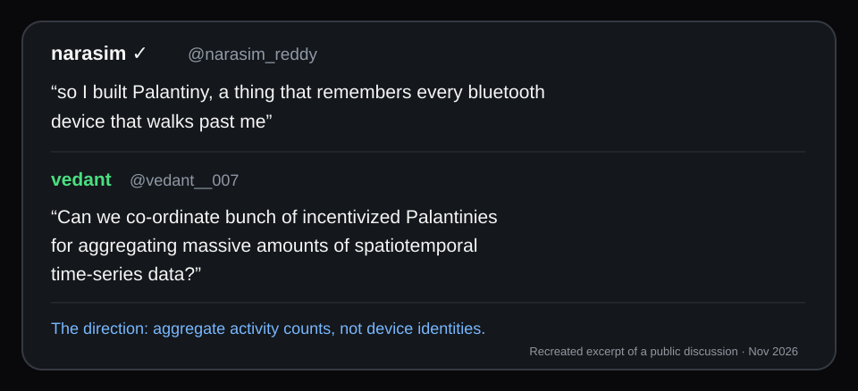
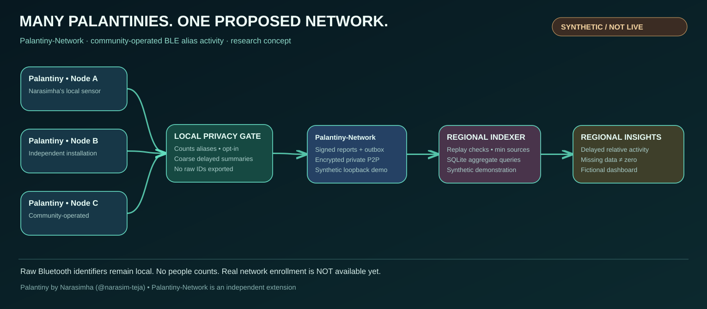

# Palantiny-Network

**Connecting independent Palantiny sensors into a community-operated, privacy-conscious network of delayed, regional activity signals.**

[](https://github.com/vedantd/pulsemesh/actions/workflows/ci.yml)  

> **Today:** a hardware-tested local BLE pipeline, an experimental **loopback-only** encrypted synthetic P2P network, and a synthetic regional dashboard. **Not** a public sensor network, people counter, smartphone app, or crowdsourced real-world map.



*Origin: [Palantiny](https://github.com/narasim-teja/palantiny) by [Narasimha (@narasim-teja)](https://github.com/narasim-teja) inspired a discussion about independently run sensors exploring **aggregate activity rather than device identities**. The image above is a recreated text excerpt, **not the original screenshot**. Palantiny-Network is an independent experiment; no author partnership is implied.*

**Evidence-gated roadmap:** [Phase A research and field calibration → Phase B trusted multi-node pilot → Phase C product experience](docs/ROADMAP_2026.md). **Tweet demo is synthetic-only** and does not represent deployed sensors.

**Current project checkpoint (read before starting new work):** [Implemented scope, unvalidated assumptions, technical debt and next product decisions](docs/PROJECT_STATUS.md). Coding agents should also read [CODEX.md](CODEX.md).

## One Palantiny is a local sensor. Many Palantinies could become a network.

[Palantiny](https://github.com/narasim-teja/palantiny) is Narasimha's independent, open-source, local-first BLE sensing application. **Palantiny-Network is our separate extension:** a local privacy adapter, signed aggregate queue, private peer-to-peer transport, and regional aggregation/query prototype. We do not fork, redistribute or control Palantiny, and upstream has not endorsed this work.



[Edit the Excalidraw network diagram](assets/palantiny-network-overview.excalidraw) · [How participation would work](docs/JOIN_THE_NETWORK.md) · [Editable participation diagram](assets/palantiny-network-participation.excalidraw)

**Prototype status:** A macOS scan integration has been exercised and a **synthetic, loopback-only** multi-node network has been demonstrated. **There is no live mesh of Palantiny installations to join yet.** Volunteer enrollment and consented real-data exchange belong to the planned permissioned pilot. The drawing is a *proposed connection model*, not deployed topology.

**Naming:** The project name is **Palantiny-Network** (repo/package slug: `palantiny-network`). Existing `pulsemesh.*` protocol/schema identifiers remain unchanged for backward compatibility; they are internal versioned wire formats, not user-facing branding. The GitHub repository URL currently retains its original `vedantd/pulsemesh` slug until repository settings are renamed.

**Engineering audit:** [M01–M06 review, hardening decisions, and remaining risks](docs/ENGINEERING_REVIEW.md).

**Engineering cleanup:** [P0 refactor notes](docs/REFACTOR_NOTES.md) describe the receiver interface, local data-loss counters, and remaining reliability gates.

**Storage lifecycle:** [SQLite compatibility and recovery policy](docs/STORAGE.md).

## Why build this?

Imagine a future network that people can join by running Palantiny plus a separately opted-in network adapter on supported hardware:

1. **Sense locally.** A node passively observes nearby Bluetooth Low Energy advertisements, subject to operating-system permissions.
2. **Aggregate privately.** On-device software creates time-bucketed, coarse-location **activity signals** and discards identifying fields before any potential release.
3. **Join the network.** The long-term design uses existing P2P libraries for peer discovery, secure exchange, and independently run participants.
4. **Explore the map.** A shared, delayed heatmap could reveal relative activity trends over time—*only* where coverage and privacy safeguards allow.

**Crucial distinction:** BLE aliases are **not people counts**. Many devices rotate identifiers; some people carry several discoverable devices, others none, and stationary electronics introduce background signals. Calibration and uncertainty reporting are prerequisites for stronger claims.

### Intended system

```text
  Palantiny A       Palantiny B       Palantiny C
  (independent installations / proposed contributors)
       |                |                |
       v                v                v
  local privacy     local privacy     local privacy
  + opt-in gate     + opt-in gate     + opt-in gate
       |                |                |
       +----------- signed coarse reports --------+
                            |
              private encrypted libp2p
                  (synthetic local demo)
                            |
                durable regional index
                  (synthetic local demo)
                            |
                 fictional zone insights
                  (localhost only today)

  NOT YET: live volunteer nodes, trusted locations,
           real-sensor P2P publishing or public map
```

**What does not leave a sensor:** raw Bluetooth identities, MAC addresses, manufacturer payloads, device names, Find My keys, Wi-Fi BSSIDs, or device-level location trails. Simple thresholding or coarse cells alone do not guarantee anonymity. Sensor locations and P2P metadata introduce additional privacy considerations.

## What works now

| Component | State | Notes |
| --- | --- | --- |
| Windowed BLE alias aggregation | Implemented / tested | Local only; counts aliases, not individuals |
| Export schema and consent gate | Implemented / tested | Allowlisted aggregate fields, delay and threshold; not a formal privacy guarantee |
| Bounded JSONL event parser | Implemented / tested | Reads compatible Palantiny-style BLE events |
| Local Unix socket relay | Implemented / simulated | Forwards original bytes unchanged to Palantiny |
| Offline synthetic demonstration | Implemented | No hardware scanning or network calls |
| Signed aggregate reports and durable outbox | Implemented / synthetic only | Opt-in local queue, Ed25519 verification and crash recovery; no sender |
| libp2p network | Experimental private synthetic demo | Noise-encrypted loopback transport, signed two-contributor regional gate; no public broadcast |
| CoreBluetooth sensing | Independently tested on Mac | A 73-second diagnostic run processed 632 BLE advertisements; the repeatable one-command CLI was also successfully tested for 120 seconds on Mac |
| Local scan calibration against manual passage counts | Implemented / awaiting field trials | Correlation + quality checks; not an occupancy estimate |
| Persistent regional indexer | Experimental synthetic only | SQLite, crash-safe replay checks and multi-process local delivery |
| Interactive regional dashboard | Synthetic local demo | Fictional zones, delayed signed-indexer history, read-only localhost API; no public heatmap |

We intentionally **do not** modify Palantiny's remote access settings or expose its local device database. The relay leaves the original Palantiny server local.

## Try the prototype

Requires **Node.js 22 or newer**.

```bash
git clone https://github.com/vedantd/pulsemesh.git
cd pulsemesh
npm test
npm run demo
```

The demo uses **synthetic data** and requires no BLE permissions. It prints an aggregate observation; it does not scan devices or publish to a public network.

### Repeatable local macOS scan (experimental)

The [M01b diagnostic](docs/LOCAL_SCAN.md) runs Palantiny's built macOS
CoreBluetooth sensor through a temporary local Unix socket and prints
**aggregate-only** results. It does **not** publish to a P2P network.

```bash
# First build the native app in your sibling ../palantiny checkout.
npm run scan -- --seconds=120 --window-seconds=20
```

The command has automated fixture tests and was exercised end-to-end
on macOS hardware during M01b. A fresh hardware scan was **not** part
of the pre-M07 engineering audit. It excludes the
partially observed first window and keeps the normal release delay
separate from the local diagnostic display.

### M06: interactive synthetic regional dashboard

A localhost-only [Insights dashboard](docs/DASHBOARD.md) visualizes
five **fictional** regions, aggregate activity scores, coverage warnings,
and 24/48-hour history. The backend seeds the real M05 SQLite indexer
with signed **synthetic** observations. It does not scan, track, publish,
or ingest real sensor data.

```bash
npm install
npm run dashboard
# Open http://127.0.0.1:4177
```

### M05: persistent regional indexer (synthetic only)

The [M05 test harness](docs/DURABLE_INDEXER.md) launches **three independent
Node.js processes**, connects contributor outboxes to a persistent SQLite
regional indexer over private, Noise-encrypted libp2p streams, then simulates
a lost acknowledgment and indexer restart.

```bash
npm install
npm run network:durable
```

The indexer deduplicates already-committed reports across restarts, rejects
stale sequences, and provides time-series queries for multi-contributor
experimental activity indices. **Still loopback-only and synthetic**—no
public API, Internet P2P, real-world sensor data transfer, or anonymity
guarantee.

### M04: three-node private network (synthetic only)

The network spike connects two contributor peers to one regional aggregator
using **libp2p TCP, Noise encryption and Yamux**. This is an *explicitly
loopback-only demonstration* with preselected peers and no public broadcast.
Only generated synthetic signed activity reports are exchanged.

```bash
npm install
npm run network:demo
```

See the [M04 protocol and security limitations](docs/PRIVATE_NETWORK.md).
In particular, no real scan data is wired to the transport, and the
aggregator is in-memory and not yet designed for public participation.

### M03: signed reports and durable local outbox

We now have an offline Ed25519-signed aggregate-report format and an
opt-in, SQLite-backed outbox for future reliable transmission. The module
**never sends data** and is **not wired into real sensor collection**.

```bash
npm run outbox:demo
```

The demonstration creates a disposable identity, queues one
**synthetic** privacy-gated observation and verifies its signature. See
[M03 protocol, queue and security notes](docs/SIGNED_OUTBOX.md).

### M02: validate the signal against manual counts

Our next field milestone is checking whether changes in local Bluetooth alias
activity actually correspond to changes in pedestrian passage activity.
**Do not interpret BLE aliases as people.**

```bash
# Complete a local, aggregate-only experiment (Palantiny sensor required):
mkdir -p calibration-data
npm run scan -- --seconds=1500 --window-seconds=60 \
  --summary-file=calibration-data/pilot-01.json

# Make an exact UTC time-bucket template; fill counts observed concurrently:
npm run calibrate -- --scan=calibration-data/pilot-01.json \
  --template=csv > calibration-data/pilot-01-manual.csv

# Generate descriptive correlation, coverage, and data-quality results:
npm run calibrate -- --scan=calibration-data/pilot-01.json \
  --manual=calibration-data/pilot-01-manual.csv
```

See the [M02 calibration protocol](docs/CALIBRATION.md), especially its
instructions for synchronized independent manual counts and no raw device logs.
The calibration export remains local: it is **not** a P2P publishable payload.

### Try the Palantiny integration on macOS

The macOS integration uses a local Unix socket relay between Palantiny's native scanner and its Bun server. You also need macOS 14+, Bun, and Xcode Command Line Tools.

**Follow [M01: macOS integration guide](docs/PALANTINY_INTEGRATION.md)** for the exact three-terminal setup and permission checks. The local relay itself was exercised with simulated sockets; the separate M01b CoreBluetooth scan workflow was also verified on macOS hardware. Neither experiment connects real sensor data to a remote network.

## Roadmap

- **P0 — Foundation:** sensor event format, bounded aggregation, privacy constraints, automated tests.
- **P1 — Hardware verification and calibration:** connect real sensors, measure scan quality, compare activity with independent ground truth.
- **P2 — Decentralized exchange:** signed aggregate observations, replay protection, durable outbox, libp2p peer discovery and pub/sub.
- **P3 — Regional queries:** independent indexers, overlapping coverage, minimum-node release requirements, and historical series.
- **P4 — Map:** delayed, coverage-aware heatmap with clearly labeled uncertainty.
- **P5 — Hardening:** security review, adversarial data validation, operational metrics and privacy assessment.
- **Later:** incentives and additional sensor platforms, only if fundamental sensing and privacy assumptions hold.

Track work in [GitHub Issues](https://github.com/vedantd/pulsemesh/issues) and read the [detailed roadmap](docs/ROADMAP.md) and [security notes](SECURITY.md).

## Relationship to upstream Palantiny

[Palantiny](https://github.com/narasim-teja/palantiny) is an independent, **local-first** open-source application by Narasimha (@narasim-teja). Palantiny-Network currently uses its documented event format as an integration target, **without copying or distributing Palantiny's source code**. We plan to propose a narrow, optional upstream event hook if its maintainer is interested. No upstream PR or endorsement is assumed.

## Contributing

Start with an [issue](https://github.com/vedantd/pulsemesh/issues). Useful areas include Linux/Raspberry Pi sensing, calibration datasets, libp2p transport, spatial indexing, and security/privacy reviews. Avoid posting real device identifiers or raw radio captures in issues.

**Project maturity:** research prototype. Do not rely on it for personal surveillance, precise crowd counting, safety monitoring, or decisions affecting individuals.
