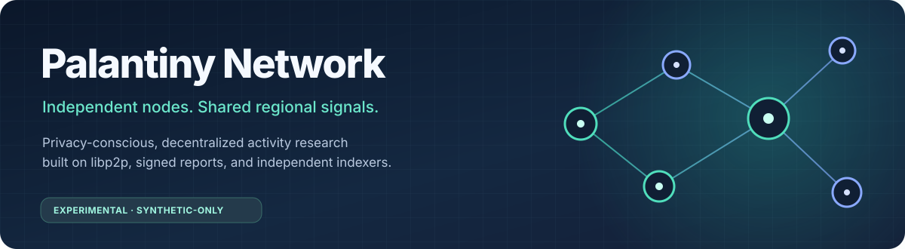
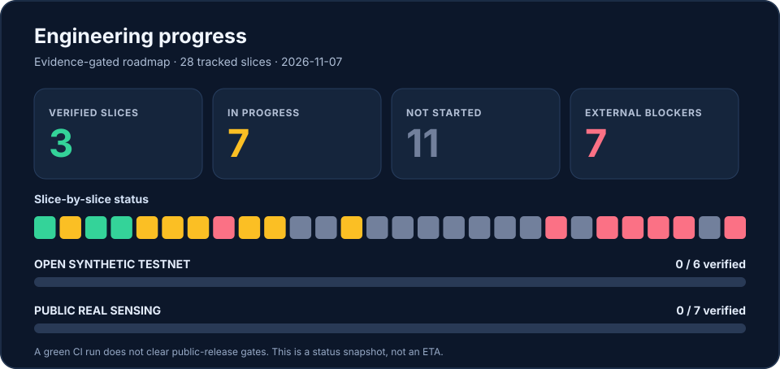

### A community-operated network for privacy-conscious regional activity research

**Independent contributors · Encrypted P2P exchange · Independently operated regional indexers**

[**Quick start**](#quick-start) · [**Architecture**](#architecture) · [**Progress**](#engineering-progress) · [**Roadmap**](#roadmap-to-public-participation) · [**Contribute**](#contributing)

# Palantiny-Network

> [!IMPORTANT]
> **Source code is public; the participant network is not.** This is a private/local **synthetic prototype**, not a calibrated people counter, real-world map or open sensor network. **There is no live mesh of Palantiny installations to join yet.** Please **do not publish real BLE observations or invite untrusted peers**. Open synthetic and real-sensing releases have separate safety gates.

## The idea

One [Palantiny](https://github.com/narasim-teja/palantiny) installation can observe nearby Bluetooth activity **locally**. What if independently operated installations could contribute *coarse, delayed, consented regional activity signals*—without submitting raw device identities to a central collector?

**Palantiny-Network** is an independent extension of that idea: a local privacy boundary, signed reports, encrypted peer-to-peer networking and independently owned regional archives. **BLE aliases are not people counts**; location, coverage, statistical reliability and privacy require validation.

<em>Conceptual architecture, not deployed topology.</em> <a href="assets/palantiny-network-overview.excalidraw">Edit in Excalidraw</a>

## Architecture

These parts have been exercised with **synthetic data** on localhost or isolated Docker networks:

~~~mermaid
flowchart LR
  A["Signed synthetic contributors"] --> B["Encrypted libp2p Noise + GossipSub"]
  B --> C["Indexer A SQLite"]
  B --> D["Indexer B SQLite"]
  C <-->|"verified archive sync"| D
  C --> E["Local synthetic dashboard"]
  D --> E
~~~

| Layer | Implemented in private demos | Still to build or validate |
| :-- | :-- | :-- |
| **Local sensing** | macOS diagnostic, bounded aggregation, opt-in export rules | Calibrated activity signal and field consent |
| **P2P transport** | Signed reports, libp2p/Noise/GossipSub, pinned private peers | Untrusted Internet transport, NAT and public bootstrap |
| **Discovery** | Localhost Kademlia discovers two indexers by a **fictional region CID**, verifies Peer ID-bound signed coverage (#92) | Independent physical hosts, churn/NAT, and privacy-reviewed real geographic mapping |
| **Regional query** | Two DHT-discovered indexers return peer-ID-signed thresholded synthetic aggregates; disagreement and missing-data checks (#94) | Host independence, partitions, freshness/churn, real geo/privacy validation |
| **Regional storage** | Durable SQLite, signed archive sync, replay protection | Independent physical-host recovery and backups |
| **Trust** | Private peer approval and revocation watcher; locked CI/SBOM | Race-safe revocation, signed releases, independent review |

**Verified localhost synthetic milestones (#92 and #94):** fictional region key → Kademlia content-provider lookup → two signed and approved indexer identities → Noise-encrypted regional aggregate reads from separate SQLite stores → explicit consistent / no-data / disagreement results. **Next:** harden D03 quorum through partitions and churn, and validate H03 on two actually independent hosts. These were **one-machine tests**, not independent physical operators. A DHT provides **discovery, not location truth, data availability, or a database**.

[Design contract](docs/PUBLIC_RELEASE_EXECUTION_PLAN.md) · [Regional DHT proof](docs/ADR_D02A_PRIVATE_REGION_PROVIDERS.md) · [Indexer sync](docs/M09_INDEXER_SYNC.md)

## Engineering progress

The chart is generated from the [28-slice execution tracker](config/release-execution-tracker.json) and [release evidence ledger](config/public-release-gates.json). **Slice counts are not completion percentages**; CI passing does not count as external release approval.

**Verified on `main`:** release policy and threat model, private approved-peer enforcement, reproducible locked dependencies, and [#94 signed two-indexer regional aggregate comparisons](https://github.com/vedantd/palantinty-network/pull/94) with [full CI evidence](https://github.com/vedantd/palantinty-network/actions/runs/42423722670). Several working prototypes remain *partial* until their full acceptance tests and deployment evidence are available. The [landing-page PR #78](https://github.com/vedantd/palantinty-network/pull/78) passed **198 automated tests** and private Docker integration in [CI run 42399271410](https://github.com/vedantd/palantinty-network/actions/runs/42399271410). The live CI badge reflects subsequent changes.

> [!NOTE]
> **No public release gates have passed:** open synthetic testnet **0/6**, real-sensor public release **0/7** additional gates. This is a deliberately blocked-by-default status.

Refresh the visualization after changing the reviewed trackers with `npm run roadmap:render`; `npm test` checks the committed graphic has not drifted.

## Quick start

Requires **Node.js 22+**. Everything below uses **fictional/synthetic input**, not the public Internet or real BLE publishing.

~~~bash
git clone https://github.com/vedantd/palantinty-network.git
cd palantinty-network
npm ci --ignore-scripts --no-audit --no-fund
npm test

npm run network:gossip      # signed synthetic mesh and two local indexers
npm run network:dht         # local-only known-Peer-ID routing
npm run network:region-dht  # find and verify two indexers for a fictional region
npm run network:region-query # read two signed regional aggregates; reject disagreement
npm run network:auto-sync   # authenticated, private indexer recovery
npm run dashboard           # local fictional region history
~~~

See the [prototype demo catalog](docs/PROTOTYPE_DEMOS.md) for more commands, private operator setup, outage/restart drills, hardware diagnostics and calibration instructions.

## Roadmap to public participation

| Phase | Deliverable | Current state |
| :-- | :-- | :-- |
| **01 — Private foundation** | Encrypted synthetic P2P, independent archives, approved peers | **Working demo; hardening ongoing** |
| **02 — Geographic discovery** | Signed fictional region coverage, private Kademlia lookup and bounded regional aggregate comparison | **Two-indexer synthetic query demonstrated on localhost; D03a/D03b partial** |
| **03 — Operational independence** | Two actual separately administered hosts, recovery, backups and revocation safety | **Not independently verified** |
| **04 — Open synthetic testnet** | Untrusted enrollment, abuse resistance, live operations and all six release gates | **Blocked** |
| **05 — Real sensing** | Calibration, consent, retention/deletion, anti-Sybil, legal and privacy reviews | **Blocked; separate seven gates** |

The [**full execution roadmap**](docs/PUBLIC_RELEASE_EXECUTION_PLAN.md) includes prerequisites and per-slice acceptance conditions. Follow the [engineering ledger](docs/ENGINEERING_EXECUTION_LOG.md), [project status](docs/PROJECT_STATUS.md) and [open issues](https://github.com/vedantd/palantinty-network/issues).

## Contributing

The repository is open to **code, documentation, tests and security/privacy review**—particularly around libp2p discovery, data integrity, operator recovery and regional aggregation. Public real-sensor participation is **not** open. Do not upload raw BLE identifiers, radio captures, private keys or unconsented observations.

Start with a [GitHub issue](https://github.com/vedantd/palantinty-network/issues), read [CODEX.md](CODEX.md) for development context and [SECURITY.md](SECURITY.md) for safety and disclosure guidance.

### Upstream relationship

Inspired by [Palantiny](https://github.com/narasim-teja/palantiny) by [Narasimha (@narasim-teja)](https://github.com/narasim-teja). **Palantiny-Network is an independent project**, not a fork or endorsed upstream collaboration. Internal `pulsemesh.*` wire identifiers are retained for backward compatibility. The GitHub repository URL retains the historical spelling `palantinty-network`.

Experimental research · No validated people counts · No public participant mesh · No network-published real BLE data
