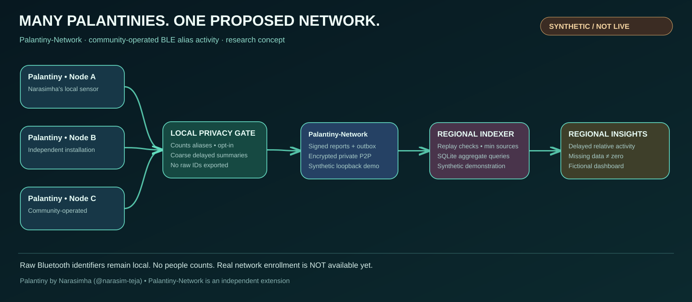

# Join Palantiny-Network — participation guide

**Palantiny** by [Narasimha (@narasim-teja)](https://github.com/narasim-teja/palantiny) is an independent local-first BLE sensing application. **Palantiny-Network** is a separate open-source research extension that aims to connect *independently operated Palantiny installations* through locally aggregated, delayed, signed regional observations. It is **not** an upstream fork, partnership, or endorsement.

> **Current reality:** You cannot join a public Palantiny network yet. There is no public relay, automatic node registration, verified location enrollment, real sensor-to-network integration, or privacy-reviewed real-data deployment. The multi-process private network and regional dashboard are **synthetic-only demonstrations**, including an isolated, permissioned Docker bridge network. **They are not publicly joinable.**



## What you can do today

1. Explore Narasimha's [Palantiny repository](https://github.com/narasim-teja/palantiny) and its own installation instructions. Do not assume it transmits data to Palantiny-Network.
2. Clone the [Palantiny-Network prototype](https://github.com/vedantd/palantinty-network) separately and install Node.js **22 or newer**.
3. Run the independent, *synthetic* network and dashboard demos:
   ```sh
   npm install
   npm test
   npm run network:durable
   npm run dashboard
   # Open http://127.0.0.1:4177 on the same machine
   ```
   The multi-process network demo sends synthetic signed reports; it does not contact other volunteers or transmit real nearby-device observations.
4. On supported macOS hardware, read [LOCAL_SCAN.md](LOCAL_SCAN.md) and [PALANTINY_INTEGRATION.md](PALANTINY_INTEGRATION.md) for the optional, **local-only** Palantiny CoreBluetooth scan. That CLI is a research diagnostic; it does not enroll a node or broadcast local scans.
5. To contribute, open an [issue](https://github.com/vedantd/palantinty-network/issues) about calibration, privacy review, the Palantiny adapter, Linux/other sensor support or the future permissioned pilot. Never post identifiers, Bluetooth dumps, precise sensor locations, or real scan artifacts to public issues.

## Proposed participation journey (not shipped)

1. Install and operate **your own Palantiny**, subject to upstream requirements and local permissions.
2. Install a **separate Palantiny-Network node**, explicitly opt in, choose an approved coarse region and understand the privacy tradeoffs.
3. A **local privacy boundary** aggregates rotating BLE aliases into complete windows and enforces thresholds and release delay. Raw observations stay local.
4. A node signs only allowlisted region/time/index summaries and queues them in a durable local outbox.
5. After trusted enrollment and location/independence checks, encrypted peer-to-peer delivery reaches a regional indexer. Individual signing keys are **not** proof of distinct sensors.
6. A quality- and privacy-gated regional query may become visible after multiple independent contributors report adequate validated coverage. The UI displays **relative BLE alias activity**, never people counts.

**Unimplemented gates:** consent UX, authenticated provisioning, location attestation, independent sensor verification, field calibration, retention/incident policies, public discovery, secure remote infrastructure and real-data publishing. These must precede recruitment of public live-data nodes.

## Why this extension exists

One Palantiny helps someone understand *their local environment*. Connecting many independent Palantinies **could** help a community study how places change over time while minimizing tracking. That is the experiment—not an operational claim.

[Editable Excalidraw architecture](../assets/palantiny-network-overview.excalidraw) · [Editable participant flow](../assets/palantiny-network-participation.excalidraw) · [Project status](PROJECT_STATUS.md) · [Evidence-gated roadmap](ROADMAP_2026.md) · [Public participation phases](PUBLIC_PARTICIPATION_ROADMAP.md)

**Wire compatibility:** existing `pulsemesh.*` schema and protocol strings are retained internally to avoid breaking signed reports and persisted databases. This is separate from user-facing naming.
