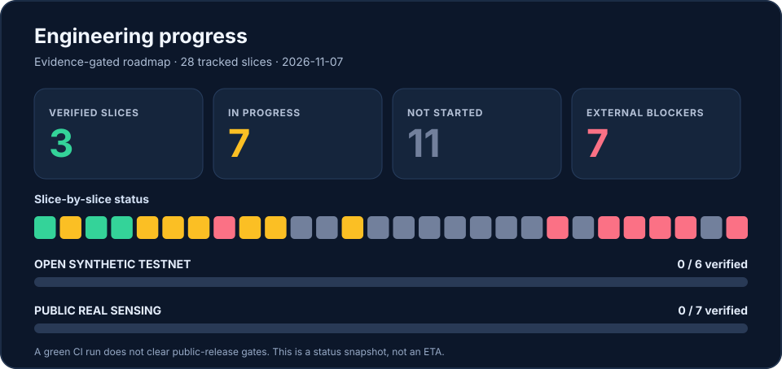

# Palantiny-Network — public participation launch roadmap

**Date:** 2026-11-06. **Current state:** public source code with tested private synthetic libp2p demos; **not** an open participant network. This is a planned and evidence-gated sequence, not a promise of release dates.

## Audited engineering update — 2026-11-07



The detailed [28-slice release execution plan](PUBLIC_RELEASE_EXECUTION_PLAN.md) and [machine tracker](../config/release-execution-tracker.json) supersede the coarse P00–P08 labels for execution. **Completed:** release gates/threat model (F00), private peer runtime approval (H00), reproducible dependency installs (H01a). **Partial:** private P2P/indexer convergence, supply-chain signatures, trust ledger/revocation and indexer recovery. In particular, P01 operator tooling, H1 policy regression tests and offline evidence-manifest tooling exist, but **two independent physical operators have not run the private pilot**. There is no public enrollment, public regional DHT lookup or real-sensor network.

Formal release gate counts remain **synthetic 0/6** and **real-sensing 0/7**; the 28-slice chart represents engineering *status categories*, not readiness percentages. See the [README](../README.md) for a clear current architecture and [demo catalog](PROTOTYPE_DEMOS.md) for local experiments.

## Two distinct launch targets

**A. Open synthetic testnet** — anyone can obtain the source and run a peer without sharing real Bluetooth observations. May admit untrusted test participants only after public network hardening. No independently supplied data is represented as verified sensing.

**B. Public real-sensing network** — opted-in real sensors with site permissions and calibrated, delayed activity signals, independently reviewed privacy and retention controls. No public data release simply because the software network is open.

## Execution order

| Slice | Outcome | Testing/exit criteria |
| --- | --- | --- |
| P00 | Release gates, threat model, backlog | CI validates complete blocked ledger and dependency of real-sensing on synthetic-testnet |
| P01 | Standalone synthetic-only operator runtime, no shared Docker volume | **P01a/P01b:** standalone runtime, operator preflight/manifest and synthetic fixture/runbook implemented; H0 runtime approval and #77 evidence-manifest preflight merged; actual two-admin physical-host evidence still required |
| P02 | Secure public transport: non-wildcard remote listeners, resource limits, bootstrap policy | Unauthorized peers, malformed frames, traffic floods, slow peers, NAT/relay testing |
| P03 | Open synthetic enrollment and node lifecycle | Join/leave/ban/revoke, pinned identity, downloadable packages, default-deny real sensing |
| P04 | Replicated archive hardening, observability and incident playbooks | Fault tests, network partitions, database backup/restore and monitoring, no silent divergence |
| P05 | Sybil resistance and verified contributions | Multiple keys cannot be treated as multiple independently attested sensors; abuse tests |
| P06 | Calibration and privacy field protocol | Site consent/permissions, ground truth, holdouts, false positive analysis, independent review |
| P07 | Restricted real-sensor pilot | Explicit opt-in, metadata minimization, retention/deletion exercise, coverage suppression |
| P08 | Gradual public real-sensing eligibility | Security/privacy signoff, operation owners, transparent limitations and rollback |

## Critical decisions

1. **Never merge synthetic and real release tracks.** An unsigned or unverified internet user's synthetic result must not influence public regional insights. Use separate namespaces, service contracts and data stores.
2. **Data ownership is distributed; trust need not be universal.** Nodes can run without a central data collector; publishing verified measurements still requires a defined independent-attestation policy.
3. **Existing encrypted libp2p is not proof of anonymity, integrity of observations, location or independence.** Stable signing keys and coarse region/time combinations remain linkable.
4. **Do not expose per-signer signed reports on public GossipSub.** Privately exchanging signed archives among verified indexers does not authorize publishing that metadata on an untrusted mesh.
5. **Public onboarding requires abuse controls and a safe kill switch.** Peer admission, resource limits, rate limiting, rekeying, and incident handling must be tested before enabling public listeners.
6. **Remote deletion cannot be guaranteed just by deleting the local outbox.** Decide retention durations, replication and withdrawal semantics before real sensor releases.
7. **Do not claim a proven cross-machine Internet test until actual independently administered hosts have passed.** A Docker bridge test is not such evidence.
8. **No blockchain/token is necessary** for the initial synthetic mesh or verified regional summaries.

## Go/no-go procedure

`config/public-release-gates.json` lists blocked gates separately for the synthetic testnet and real-sensing network. Run:

```bash
npm run release:check -- open-synthetic-testnet
npm run release:check -- public-real-sensing
```

A nonzero exit status means not ready. Changing a gate to verified requires an auditable, reviewed external evidence reference, and these files are a **human-maintained evidence ledger, not a secure production authorization service**. Independent reviewer signoff and operational ownership are separate prerequisites.

## Release management

Keep PRs small and anchored in explicit acceptance tests. Each slice updates this plan, [PROJECT_STATUS.md](PROJECT_STATUS.md), security notes and CI. Do not silently open public network interfaces or activate real sensor publishing. Publish accepted issues/PRs for community software participation, but do **not** invite real-world volunteers to share observations until P07's gates are satisfied.

## P02c-1 restricted-private transport checkpoint

An opt-in pinned RFC1918 synthetic GossipSub transport and isolated two-container demo are now available. This does not complete P02: actual independently administered host evidence, hostile remote-load testing, emergency disable procedures, public Internet NAT/bootstrap policy, onboarding and operational signoff are outstanding. All release gates remain blocked. See [P02C_PRIVATE_OVERLAY.md](P02C_PRIVATE_OVERLAY.md).


## P02c-2 independent-host execution checkpoint

Operator-specific persistent identity and private configuration CLI, synthetic-only receive/publish commands, offline evidence reviewer, and repeated local separate-process test are provided. **No independent physical-host deployment has been observed**, and reviewer output explicitly reports `remoteHostsVerified:false`. All public safety/release gates remain blocked. See [P02C_INDEPENDENT_HOST_PILOT.md](P02C_INDEPENDENT_HOST_PILOT.md).


## P02c-3 private-pilot operational safety

Local stop/revoke/resume and connection-health telemetry have been added for the pre-public pinned synthetic host pilot; no public listener, open enrollment or real BLE publishing is enabled. This does not satisfy independently administered physical-host, incident ownership, hostile Internet fault testing or public supply-chain gates. See [P02C_OPERATOR_CONTROLS.md](P02C_OPERATOR_CONTROLS.md).


## P02c-4 synthetic outage and incident review checkpoint

Adds an automated two-process localhost baseline → outage → recovery test, local peer revocation check, and a bounded offline incident transcript reviewer. This does not validate independently operated physical hosts or private-overlay firewall partition, and does not close any release gate. See [P02C_INCIDENT_DRILL.md](P02C_INCIDENT_DRILL.md).


## P03a local enrollment checkpoint

A bounded, durable offline candidate/approve/revoke registry establishes operator-reviewed private synthetic peer state, with no network advertising, no runtime-config activation and no open enrollment. See [P03_PRIVATE_ENROLLMENT.md](P03_PRIVATE_ENROLLMENT.md). P03 public lifecycle and all release gates remain incomplete.


## H0 security hardening and refreshed engineering plan (2026-11-07)

The standalone private P02c synthetic pilot now requires an approved local P03a enrollment ledger entry before startup and polls for revocation and local policy drift. This closes the earlier **advisory-only** gap for that pilot but does **not** close public admission, physical-host, release supply-chain or real-sensor gates. The separate P03d audit API remains read-only. See [targeted findings](HARDENING_AUDIT_2026_11_07.md) and the [prioritized next slices](EXECUTION_ROADMAP_NEXT.md); all release gate statuses remain blocked.

## P03b operator-reviewed peer activation staging

Only approved private peer pins from an explicitly reviewed P03a ledger revision may be staged into a new pilot configuration. The running process does not reload it automatically. Public enrollment, automated discovery and real sensor sharing remain disabled. See [P03_PRIVATE_PEER_STAGING.md](P03_PRIVATE_PEER_STAGING.md).
