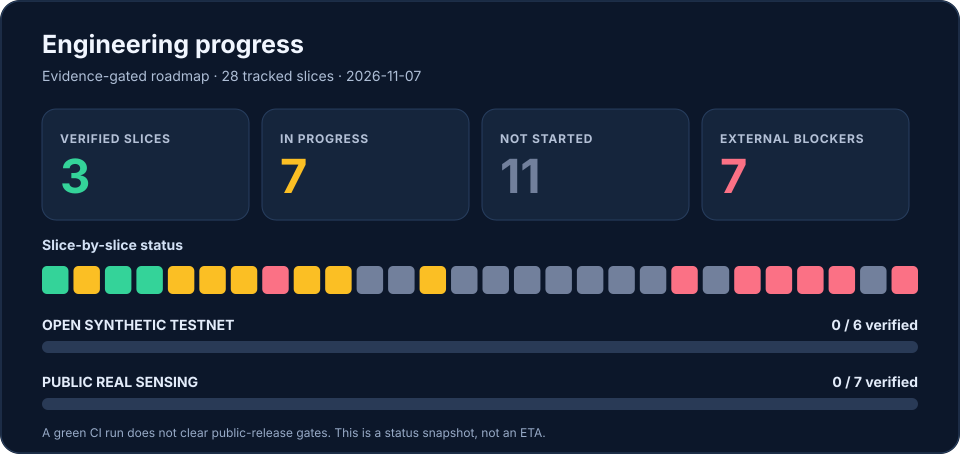

# Palantiny-network — engineering execution plan through public release

**Plan created:** 2026-11-07. **Scope:** finish a trustworthy, open-source, decentralized network for independent regional activity signals, with an **open synthetic testnet first** and **real BLE-derived observations only after a separate science/privacy/rights review**. This is a dependency-ordered *backlog and release contract*, not a promise of public launch on 2026-11-07.

## Latest audited engineering checkpoint · 2026-11-07

**Formal tracker:** **3 done**, **6 partial**, **12 planned**, **7 externally blocked** (28 total). These are *slice states*, not percentage completion or an ETA. Current public release gate evidence is **0/6 verified** for the synthetic testnet and **0/7 verified** for real-sensing. A green GitHub Actions run never substitutes for independent operators, field tests, or privacy/security approval.

**Verified recent merges:** [#70 reproducible Node 22 dependencies](https://github.com/vedantd/palantinty-network/pull/70), [#72 immutable CI Actions and CycloneDX SBOM](https://github.com/vedantd/palantinty-network/pull/72), [#76 security regression tests](https://github.com/vedantd/palantinty-network/pull/76), [#77 two-host evidence-manifest validation](https://github.com/vedantd/palantinty-network/pull/77). The README/progress redesign [PR #78](https://github.com/vedantd/palantinty-network/pull/78) was merged with [CI run 42399271410](https://github.com/vedantd/palantinty-network/actions/runs/42399271410): **198/198 tests passed**, including private Docker suites. This documentation milestone does not advance any technical implementation slice or public release gate. [PR #74](https://github.com/vedantd/palantinty-network/pull/74) was replaced by [merged PR #80](https://github.com/vedantd/palantinty-network/pull/80), verified in [CI run 42401338305](https://github.com/vedantd/palantinty-network/actions/runs/42401338305): 200/200 tests; this covers only one-way watcher rollback regression. [Original PR #75](https://github.com/vedantd/palantinty-network/pull/75) was closed as superseded by [merged PR #81](https://github.com/vedantd/palantinty-network/pull/81), which fixes a valid-public-key verifier error and adds negative coverage tests; full [CI run 42401745685](https://github.com/vedantd/palantinty-network/actions/runs/42401745685) passed **206/206 tests**. This is offline fictional-region signing only: D01b is **partial**, D01a remains planned, and D02 geographic DHT discovery is not implemented.

**Near-term manual engineering order:** H02 transactional peer revocation → I01 indexer backup/restore → D01 canonical coarse-region/coverage and key binding → D02 regional provider discovery using existing libp2p Kademlia → D03 authenticated bounded query/comparison → H03 independent-host validation → N01/N02/N03 public synthetic operation hardening. In parallel, finish H01b tagged signed build and vulnerability response. **Do not advance a launch gate from a mock or localhost run.**

**Progress graphic maintenance:** `npm run roadmap:render` regenerates the SVG from the execution tracker and public evidence ledger. `npm test` rejects stale graphics.

## Architecture contract (preserve throughout)

- Each node owns a persistent cryptographic identity; connections are Noise-encrypted libp2p. A participant is **not automatically an indexer**.
- GossipSub distributes permitted synthetic/coarse reports; it does **not** guarantee durable delivery, receive authorization or archival.
- Independent **indexers** opt in to store only the regions, reports and signed histories they agree to host. A peer is not compelled to pool every observation.
- A client chooses a coarse region key, uses *private first, public later* Kademlia lookup to find candidate indexers, authenticates a versioned, signed, short-lived indexer-coverage advertisement, and queries those indexers directly. DHT membership is **discovery, never truth, trust, location proof, or a database**.
- Coverage requires multiple independent indexers, privacy-preserving aggregation, and uncertainty. BLE aliases are **not** individuals or a people count.
- No central report-ingestion server is a requirement. Temporary bootstrap infrastructure is permitted only as replaceable decentralized peer discovery and must be documented; a single operator must not own the entire serving network.
- Source is public now. **Open synthetic** and **real-sensor public participation** are separate launch profiles, with independent evidence and approvals. Never automatically enable real measurement publishing, wildcard listeners, or permissionless sensor identities during development.

## Definition of done for *every* implementation slice

A completed slice has (1) documented threat/problem statement and ADR, (2) narrow source changes and focused tests including negative/adversarial cases, (3) full GitHub Actions passing and a PR merge SHA, (4) updated `docs/ENGINEERING_EXECUTION_LOG.md` and project status, (5) rollback or upgrade notes, (6) honest residual-risk notes. For public release gates, add **operator-owned external evidence, dated reviewers and signoff**. Green CI **alone never closes a release gate**.

## Execution order and acceptance matrix

**Status legend:** `done` merged and verified in CI; `partial` some code exists but not all exit evidence; `planned` design/build work remains; `blocked-external` needs operators, infrastructure, legal/privacy or independently reviewed work. Detailed machine-readable slice state lives in [config/release-execution-tracker.json](../config/release-execution-tracker.json).

| ID | Slice / goal | Prerequisite | Acceptance / stop condition | Current |
| --- | --- | --- | --- | --- |
| F00 | Public release gates and threat model | — | Machine-readable blocked-by-default gates; distinct synthetic vs real tracks | **done** |
| F01 | Local synthetic P2P + private indexer replication | F00 | Signed fictional reports, GossipSub and recoverable authorized indexer archives | **partial** (private tested; durability and remote evidence incomplete) |
| H00 | Local approved peer enforcement | F01 | Unapproved peer refuses startup, revocation interrupts active synthetic node | **done**, PR #64 |
| H01a | Reproducible Node build | H00 | Audited `package-lock.json`, `npm ci` for CI and Docker, clean repeat installs, Node version policy | **done**, PR #70 / 182 tests |
| H01b | Release supply chain integrity | H01a | Immutable CI dependencies, SBOM, dependency audit policy, SHA256 and reproducible signed/tagged artifacts, recovery drill | **partial**, pinned CI/SBOM #72 and CI policy regression tests #76 merged; signed release still blocked |
| H02a | Crash-safe operator trust storage | H00 | Explicit permission checks, secure atomic state transitions, expected-revision CAS, symlink/partial-write/fault tests | **partial**, #66 |
| H02b | Live revocation/identity replacement | H02a | Kill connection under in-flight Noise/publish, no stale pin reuse, tested restart/rotation and manual exit | **partial**, #66; #74 watchdog rollback tests still open |
| H03 | Independent two-admin physical-host pilot | H01a,H02b | Two independently controlled machines; VPN/firewall and peer-ID audit; outage, identity, resource and incident evidence | **blocked-external**, #67; offline evidence preflight #77 merged, physical-host test not performed |
| I01 | Indexer backup/restore integrity | H01a,F01 | Snapshot + recovery of SQLite and signed archives, checksum chain and recovery point tests | **planned** |
| I02 | Indexer archive convergence/failover | I01 | Partitions, conflict/replay, duplicate/expiry, restart, migration, dual-indexer reconciliation | **partial** |
| I03 | Monitoring and incident operations | H03,I02 | Metrics, rate budgets, runbook, controlled kill, backups, incident contacts, ownership and alert drills | **planned** |
| D01a | Canonical coarse-region mapping and privacy contract | F00 | Deterministic region IDs, versioning and minimum granularity; no single-sensor/sensitive site leakage | **planned** |
| D01b | Signed indexer coverage advertisement | D01a,H02b | TTL-bounded, cryptographically verified Peer ID, region, capability, namespace and endpoint; bogus/expired adverts rejected | **partial**; #81 signed fictional-region offline primitive merged, still no actual Peer ID key-binding, address policy or DHT |
| D02a | Private Kademlia indexer discovery | D01b | Two independently pinned indexers advertising one region, private DHT candidate lookup, identity checks, no central lookup server | **planned** (separate sandbox Kademlia peer demo exists) |
| D02b | Churn-resistant candidate filtering and transport | D02a,H03 | Capped lookups, fallback/TTL, peer lifecycle, NAT and relay threat modeling without tracking individual sensors | **planned** |
| D03a | Authenticated regional query protocol | D01b,I01 | Read-only bounded stream/HTTP-like libp2p protocol, signed fictional aggregates, pagination/cursors, negative schema tests | **planned** |
| D03b | Multi-indexer query verification | D02a,D03a,I02 | Query region→DHT→two indexers→validate snapshots; stale, censored, unavailable, conflicting responses flagged | **planned** |
| N01 | Untrusted Internet transport policy | H03,H01b | Secure bootstrap, NAT/relay/IPv6 stance, peer admission/rate/resource controls; adversarial load and long-running soak | **planned** |
| N02 | Public *synthetic-only* enrollment and exit | N01,H02b | Self-service consent for synthetic mode, identity creation, leave, revoke, abuse block/report, downloadable bundles; no BLE permission | **planned** |
| N03 | Multi-operator synthetic network operations | N02,I03,D03b | Independent hosting, recovery, community docs, reproducible deployment, outage escalation, abuse response and redundancy | **planned** |
| R-SYN | **Open synthetic testnet release** | N03 | **All six** `open-synthetic-testnet` gates independently evidenced, owner review, rollback and visible synthetic-only labeling | **blocked-external** |
| S01 | Real-world sensor provenance and independence | R-SYN | Prevent treating unlimited keys as independent sensors; site operator attestations, anomalies and field calibration protocol | **planned** |
| S02 | Field calibration and uncertainty | S01 | Multi-site ground truth holdouts, false positive/false negative analysis and confidence/coverage documentation | **blocked-external** |
| S03 | Consent, privacy and rights design | S01 | Opt-in/withdrawal, retention and deletion behavior across distributed replicas, sparse-cell and linkability review | **blocked-external** |
| S04 | Independent privacy/security/legal review | S02,S03 | Independent review, venue permissions and jurisdictional approvals, documented mitigation and retest | **blocked-external** |
| S05 | Consented restricted real-sensor pilot | S04 | Explicitly authorized venues/operators, no raw BLE transfer, suppression/delay, safe field test and removal drill | **blocked-external** |
| S06 | Progressive real-sensor production operations | S05,I03 | Rollout/rollback, opt-out/revoke, incident ownership, independent indexer redundancy and evidence-based limits | **planned** |
| R-REAL | **Public real-sensing network release** | R-SYN,S06 | **All seven** `public-real-sensing` gates **plus prerequisite synthetic gate set** independently signed off | **blocked-external** |

### Release gate evidence map

**Open synthetic testnet — 6/6 required:** independent-host-runtime (H03), network-abuse-controls (N01), untrusted-peer-fault-tests (N01/N02), public-enrollment-exit (N02), incident-operations (I03/N03), release-supply-chain (H01b).

**Public real sensing — separate 7/7 required:** field-calibration (S02), privacy-independent-review (S04), participant-informed-consent (S03/S05), retention-and-deletion (S03/S05), anti-sybil-location-and-independence (S01), legal-venue-approval (S04), safe-regional-publication (S05/S06). Complete synthetic prerequisites first.

## Execution process for authorized autonomous sessions

1. Read `main`, active PRs/CI, [execution tracker](../config/release-execution-tracker.json), project status, evidence log and related issues; never act on stale snapshots.
2. Choose the **earliest feasible, unblocked, high-impact slice** in this matrix, ensuring one branch/PR per coherent change. H01a first. If an existing PR is in flight, complete or document it before starting another overlapping slice.
3. Inspect dependencies and source, write focused tests, run GitHub Actions and review real output; fix failures. **Do not merge red/unknown CI**, silently delete failing tests, or narrow release-gate assertions to pass.
4. Update trackers and documentation with exact PR, commit, test, CI and known limitations. Public release gates stay blocked until independently verified.
5. An external blocker (two separately operated hosts, production credentials, legal site permission, independent reviewer) is a **hard stop on claiming completion**, not an instruction to invent evidence. Move to a safe preparatory slice or issue.

### Eight-hour sprint on 2026-11-07

The authorized work window targets engineering sessions through **approximately 3 PM America/New_York** (hourly resumptions). This is *not* an eight-hour continuous process, and **not a public-release deadline**. Priorities: H01a, H01b feasibility, H02 safety, I01, D01a/D01b where safe, docs and CI. Session work may be smaller or blocked by unavailable dependencies or tests.

**At the end of the window:** summarize merged slices, open PRs, CI links, new safety findings, current state of the 6+7 release gates and physical review dependencies. Real-world operations and public recruitment require separate authorization and evidence.
